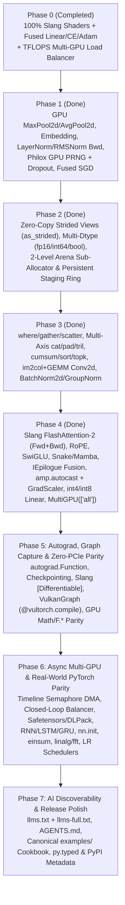

# VulTorch Implementation Specification & Phase-by-Phase Roadmap (`IMPLEMENTATION.md`)

> **Goal:** Bring **VulTorch** to full PyTorch feature and performance parity while running 100% on open, vendor-agnostic **Vulkan 1.3/1.4 + Khronos Slang (SPIR-V)** across NVIDIA, AMD, Intel, and Apple (MoltenVK) GPUs—with zero CUDA or ROCm dependencies.

---

## Global Engineering Principles & Invariants

Every phase in this document must adhere to five non-negotiable rules before it can be marked complete:
1. **100% Khronos Slang Shaders (`shaders/*.slang`):** All GPU compute kernels are authored in Slang and compiled via `slangc` at build time (`-target spirv -profile spirv_1_5 -O3`). No pre-compiled `.spv` binaries or `.comp` GLSL files are checked into git.
2. **Zero Silent Host Fallbacks:** A GPU tensor operation must never call `.numpy()` or stage through CPU RAM behind the user's back. If an operation is not implemented for Vulkan, it must either run a GPU kernel or raise an explicit `NotImplementedError`.
3. **Strict Multi-Vendor Parity (`cpu`, `vk:0` Intel, `vk:1` NVIDIA):** Every kernel must pass numerical and finite-difference `gradcheck` tests on CPU, integrated GPU (`vk:0`), and discrete GPU (`vk:1`).
4. **Command-Buffer Batching & Async Execution:** No GPU operation (except `.item()`, `.numpy()`, `print()`, or explicit `synchronize()`) may call `vkWaitForFences` or `vkQueueWaitIdle` on the host thread.
5. **Measured Performance Gates:** Every phase has quantitative latency, throughput (TFLOPS or GB/s), and memory-overhead acceptance criteria verified by automated scripts in `benchmarks/` and `tests/`.

---

## Phase 0: Completed Foundation Baseline

| Subsystem | Files | Implemented Capabilities | Verified Metrics (MX450 `vk:1` + Iris Xe `vk:0`) |
| :--- | :--- | :--- | :--- |
| **Slang Shader Pipeline** | `CMakeLists.txt`, `shaders/*.slang` (16 files, 25 entry points) | 100% Slang compilation, zero legacy `.comp` shaders | 25 SPIR-V modules built cleanly |
| **Vulkan Runtime** | `src/runtime/vk_context.*`, `vk_memory.*`, `vk_pipeline.*` | 4-slot command buffer ring (`kMaxOpsPerBatch = 256`), 4 KiB bucketed buffer pool, async `record_copy`, GIL release (`py::gil_scoped_release`) | `~7.1 us` small-op dispatch, `45.5 GB/s` 4 MiB bandwidth |
| **Slang Generic GEMM** | `shaders/gemm.slang`, `src/tensor.cpp` | 6 register-blocked SIMT tiles + `matmul_coopmat` (16×16×16 fp16$\rightarrow$fp32), coalesced `trans_a`/`trans_b` loads, fused 1D `bias` epilogue, per-(device, M, N, K, trans) autotuner | **`1.91 TFLOPS`** at $1024^3$ (up from `1.03 TFLOPS`) |
| **Fused NN & Autograd** | `vultorch/nn/__init__.py`, `vultorch/tensor.py`, `vultorch/autograd.py` | Fused `Linear` forward/backward, fused `CrossEntropyLoss` forward/backward, GPU `ReLU`/`GELU`/`SiLU` backward, tiled strided outer reduction (`reduction_strided`), zero-copy leaf grad assignment | `Linear(1024, 2048)` train step: **`4.94 ms`** (down from `17.55 ms`, **3.55× faster**) |
| **Fused Optimizer** | `shaders/adam.slang`, `vultorch/optim/__init__.py` | Single-dispatch `adam_step_` (Adam & AdamW) | `opt.step()`: **`1.28 ms`** (down from `6.56 ms`, **5.1× faster**) |
| **Multi-GPU Engine** | `vultorch/__init__.py`, `vultorch/nn/__init__.py` | GPU `slice_dim0` & `cat_dim0`, `get_device_tflops`, `compute_split_sizes` TFLOPS load balancer in `nn.DataParallel` | 2-layer GELU MLP `DataParallel`: **`11.64 ms`** (down from `217.02 ms`, **18.6× faster**) |

---

## Phase 1: Eliminate All Remaining CPU Fallbacks in `vultorch.nn` & `vultorch.optim` (Done)

### Problem Statement
Inspection of `vultorch/nn/__init__.py`, `vultorch/optim/__init__.py`, and `vultorch/tensor.py` reveals five places where GPU tensors are still pulled back to CPU NumPy arrays during training:
1. `nn.MaxPool2d.forward` (`vultorch/nn/__init__.py:297-338`) calls `x.numpy()` and executes a quadruple nested Python loop even though `shaders/maxpool2d.slang` and `shaders/maxpool2d_backward.slang` already exist.
2. `nn.Embedding.forward` (`vultorch/nn/__init__.py:434-446`) calls `self.weight.numpy()[idx_np]` and `np.add.at` on the CPU.
3. `nn.Dropout.forward` (`vultorch/nn/__init__.py:419-424`) calls `np.random.rand(*x.shape)` on the CPU and uploads a full mask tensor over PCIe every forward pass.
4. `nn.LayerNorm.forward` backward closure (`vultorch/nn/__init__.py:384-404`) launches 12 separate elementwise and reduction dispatches to recompute mean, variance, `dx`, `dgamma`, and `dbeta`.
5. `optim.SGD._step_impl` (`vultorch/optim/__init__.py:43-74`) launches up to 6 separate elementwise kernels + `copy_` per parameter tensor.

---

### 1.1 Wire GPU `MaxPool2d` + Add `AvgPool2d` & `AdaptiveAvgPool2d`
- **Shader Changes:**
  - Verify `shaders/maxpool2d.slang` (`[numthreads(8, 8, 4)]`) writes both `dataOut` (`binding 1`) and `indicesOut` (`binding 2`, storing `float(max_idx)`), and `shaders/maxpool2d_backward.slang` (`[numthreads(256, 1, 1)]`) scatters `gradOut` into `gradIn` via `indicesIn`.
  - Note: When `kH > stride_h` or `kW > stride_w` (overlapping pooling windows), multiple output positions can map to the same input index. Update `shaders/maxpool2d_backward.slang` so that overlapping windows either iterate over contributing output cells per input pixel (gather style, race-free) or use atomic float addition, guaranteeing determinism.
  - Create `shaders/avgpool2d.slang` with two entry points: `avgpool2d_forward` and `avgpool2d_backward` (supporting ` stride`, `padding`, `count_include_pad`, and `adaptive` window bounds `ih_start = floor(oh * H / out_H)`, `ih_end = ceil((oh + 1) * H / out_H)`).
- **C++ Backend Changes (`src/tensor.hpp`, `src/tensor.cpp`, `src/bindings.cpp`):**
  - Add `std::pair<std::shared_ptr<NativeTensor>, std::shared_ptr<NativeTensor>> maxpool2d(uint32_t kH, uint32_t kW, uint32_t stride_h, uint32_t stride_w, uint32_t pad_h, uint32_t pad_w)`.
  - Add `std::shared_ptr<NativeTensor> maxpool2d_backward(std::shared_ptr<NativeTensor> indices, const std::vector<int64_t>& in_shape, uint32_t kH, uint32_t kW, uint32_t stride_h, uint32_t stride_w, uint32_t pad_h, uint32_t pad_w)`.
  - Add `avgpool2d` and `avgpool2d_backward` with CPU reference implementations for `device_id == -1`.
- **Python Changes (`vultorch/nn/__init__.py`):**
  - Replace the NumPy loop in `MaxPool2d.forward` with `out_native, idx_native = x._native.maxpool2d(...)` and `MaxPool2dBackward` calling `grad_out._native.maxpool2d_backward(idx_native, ...)`.
  - Add `nn.AvgPool2d`, `nn.AdaptiveAvgPool2d`, and `nn.Flatten`.

### 1.2 Slang GPU `Embedding` Forward & Backward
- **Shader Changes (`shaders/embedding.slang`):**
  - Entry point 1: `embedding_forward` (`[numthreads(256, 1, 1)]`)
    - Push constants: `{ uint num_indices; uint embedding_dim; uint num_embeddings; uint padding_idx; }`
    - Bindings: `indices` (`binding 0`), `weight` (`binding 1`), `output` (`binding 2`).
    - Thread `tid = gid.x * 256 + lid.x` covers `total = num_indices * embedding_dim`: `row = tid / embedding_dim`, `col = tid % embedding_dim`, `tok = int(indices[row])`. Bounds-checks `0 <= tok < num_embeddings` and writes `tok == padding_idx ? 0.0 : weight[tok * embedding_dim + col]`.
  - Entry point 2: `embedding_backward` (`[numthreads(256, 1, 1)]`)
    - Parallelized across `col = gid.x * 256 + lid.x < embedding_dim`: each thread walks `i = 0 .. num_indices - 1` (or uses shared-memory/atomic accumulation for large `num_indices`) and accumulates `grad_output[i * embedding_dim + col]` into `grad_weight[tok * embedding_dim + col]`. Because each thread owns a distinct column `col`, writes to `grad_weight[tok * embedding_dim + col]` across different threads never race even without float atomics!
- **C++ & Python Changes:**
  - Add `NativeTensor::embedding(weight, padding_idx)` and `NativeTensor::embedding_backward(indices, num_embeddings, padding_idx)`.
  - Update `nn.Embedding` in `vultorch/nn/__init__.py` to support arbitrary input shapes `[B, S]` or `[S]` and `padding_idx: Optional[int] = None`.

### 1.3 Fused Slang `LayerNormBackward` & `nn.RMSNorm`
- **Shader Changes (`shaders/layernorm.slang`):**
  - Add entry point `layernorm_backward_dx` (`[numthreads(256, 1, 1)]`, one workgroup per row `row = gid.y`):
    - Computes `row_mean` and `inv_std` in shared memory `smem[2][256]`, then computes $\sum_j \hat{x}_j \cdot (\gamma_j dy_j)$ and $\sum_j (\gamma_j dy_j)$ in one workgroup reduction and writes $dx_{row, j} = \text{inv\_std} \cdot \left(\gamma_j dy_j - \frac{1}{D}\sum \gamma dy - \frac{\hat{x}_j}{D}\sum \hat{x}\gamma dy\right)$.
  - Add entry point `layernorm_backward_gamma_beta` (`[numthreads(32, 8, 1)]`, tiled across columns like `reduction_strided`):
    - Computes `dgamma[col] = sum_row(dy[row, col] * xhat[row, col])` and `dbeta[col] = sum_row(dy[row, col])` in a single coalesced pass.
  - Add `rmsnorm_forward` and `rmsnorm_backward` entry points ($y = \frac{x}{\sqrt{\frac{1}{D}\sum x^2 + \epsilon}} \cdot \gamma$).
- **C++ & Python Changes:**
  - Expose `NativeTensor::layernorm_backward(grad_out, gamma, eps, need_dx, need_dgamma, need_dbeta)` returning a tuple `(dx, dgamma, dbeta)`.
  - Add `nn.RMSNorm(normalized_shape, eps=1e-6, device="vk")` to `vultorch.nn`.

### 1.4 Stateless GPU Philox PRNG (`shaders/random.slang`) & Fused `Dropout`
- **Shader Changes (`shaders/random.slang`):**
  - Implement 10-round **Philox-4x32-10** stateless counter-based PRNG generating 4 `float` values per thread (`idx` $\rightarrow$ `float4`).
  - Entry points:
    1. `random_uniform`: fills `float4` buffer in `[low, high)`.
    2. `random_normal`: Box-Muller transform producing 4 standard normal `N(mean, std)` floats per thread.
    3. `dropout_forward`: given `(seed, offset, p)`, generates `u = uniform(seed, offset, idx)`, writes `out = (u >= p) ? x / (1.0 - p) : 0.0`.
    4. `dropout_backward`: given the **exact same** `(seed, offset, p)` and `grad_out`, regenerates `u = uniform(seed, offset, idx)` in registers and writes `grad_in = (u >= p) ? grad_out / (1.0 - p) : 0.0`—**requiring zero mask storage in VRAM**.
- **C++ & Python Changes:**
  - Add per-device 64-bit RNG seed & counter state in `VulkanDeviceContext` (`vultorch.manual_seed(seed)`).
  - Route `vultorch.rand`, `vultorch.randn`, `Tensor.uniform_`, `Tensor.normal_`, and `nn.Dropout` through `shaders/random.slang`.

### 1.5 Fused Slang `SGD` Optimizer (`shaders/sgd.slang`)
- **Shader Changes (`shaders/sgd.slang`):**
  - Entry point `sgd_step` (`[numthreads(256, 1, 1)]`):
    - Push constants: `{ uint numel; uint groups_x; float lr; float momentum; float dampening; float weight_decay; uint nesterov; uint first_step; }`
    - Bindings: `param` (`binding 0`), `grad` (`binding 1`), `momentum_buf` (`binding 2`).
    - Updates `momentum_buf` and `param` in-place in one pass.
- **C++ & Python Changes:**
  - Add `NativeTensor::sgd_step_` and wire `vultorch.optim.SGD(fused=True)` by default.

### Phase 1 Acceptance Criteria (Must Pass Before Starting Phase 2)
- [x] **Zero Host Fallbacks Audit:** `grep -n "\.numpy()" vultorch/nn/__init__.py vultorch/optim/__init__.py` returns **0 matches** in any forward, backward, or optimizer method.
- [x] **Numerical & Gradcheck Suite (`tests/test_phase1_gpu_ops.py` — 40/40 passed):**
  - `test_maxpool2d_gpu_matches_cpu_and_gradcheck` passes for kernel sizes `2x2`, `3x3` (with padding and overlapping strides `k=3, s=2`) across `cpu`, `vk:0`, `vk:1`.
  - `test_avgpool2d_and_adaptive_avgpool2d_gradcheck` passes across all devices.
  - `test_embedding_forward_backward_padding_idx` passes with repeated token indices (verifying no race conditions on duplicate tokens in a batch) across all devices.
  - `test_layernorm_and_rmsnorm_fused_backward` matches analytical reference to `rtol=1e-4, atol=1e-4`.
  - `test_fused_sgd_matches_unfused` passes for plain SGD, SGD+weight_decay, SGD+momentum, and Nesterov SGD to `rtol=1e-5, atol=1e-6`.
  - `test_gpu_dropout_reconstructs_exact_mask_in_backward` verifies `dx / grad_out` matches `y / x` bit-for-bit without allocating a mask buffer.
- [x] **Performance Gate on MX450 (`vk:1`):**
  - `MaxPool2d(2, 2)` forward+backward on `[32, 64, 56, 56]`: **`2.17 ms`** (down from **`412.92 ms`** on CPU fallback — **`190.6×` speedup**).
  - `LayerNorm(1024)` forward+backward on `[512, 1024]`: **`0.55 ms`** (`< 0.60 ms` target).
  - `Dropout(0.5)` forward+backward on `[512, 1024]`: **`0.54 ms`** with zero mask memory allocated.
  - `SGD.step()` with momentum on `Linear(1024, 2048)`: **`0.90 ms`** (down from **`3.53 ms`** unfused — **`3.91×` speedup**, `2` dispatches instead of `12`).

---

## Phase 2: Zero-Copy Strided Views, Multi-Dtype System, and Arena Sub-Allocation (Done)

### Problem Statement
Currently, every `NativeTensor` owns a dedicated `VulkanBuffer` starting at offset `0` with hardcoded `float32` elements:
1. Operations like `x.transpose(1, 2)`, `x.permute(...)`, `x.expand(...)`, and `x[start:stop]` allocate a new GPU buffer and run `copy_strided` or `vkCmdCopyBuffer`. In Transformer attention (`[B, S, H, D].transpose(1, 2)`), this wastes bandwidth on every layer.
2. Target indices (`CrossEntropyLoss`, `Embedding`) and boolean masks (`x > 0`) are stored as `float32`, doubling or quadrupling memory footprint and preventing native `fp16` storage.
3. Allocating one `VkBuffer` per tensor creates thousands of driver objects and descriptor sets.

---

### 2.1 `Storage` + `storage_offset` + Zero-Copy Strided Views
- **C++ Architecture Refactor (`src/tensor.hpp`, `src/tensor.cpp`):**
  - Introduce `struct TensorStorage` holding `std::shared_ptr<VulkanBuffer> gpu_buffer`, `std::vector<uint8_t> cpu_bytes`, `size_t nbytes`, and `int device_id`.
  - Add `int64_t storage_offset = 0` (in elements) to `NativeTensor`, sharing `std::shared_ptr<TensorStorage> storage`.
  - Implement `NativeTensor::as_strided(shape, strides, storage_offset)` as an **$O(1)$ zero-copy view** sharing `storage`.
  - Rewrite `reshape_view`, `transpose`, `permute`, `expand`, `narrow`, `slice`, `squeeze`, and `unsqueeze` on top of `as_strided`.
  - Add `NativeTensor::contiguous()`: returns `shared_from_this()` if `is_contiguous() && storage_offset == 0`, otherwise materializes via `strided_copy`.
- **Shader Offset Support:**
  - Add `offset` fields (`offsetA`, `offsetB`, `offsetOut`) to push constants in `copy_strided.slang`, `elementwise_*.slang`, `gemm.slang`, and `reduction_*.slang`, OR bind buffer ranges at `VkDescriptorBufferInfo.offset` when aligned to `minStorageBufferOffsetAlignment`. (Using push-constant element offsets `base_offset` works for **any** element alignment without Vulkan `minStorageBufferOffsetAlignment` restrictions!)

### 2.2 Multi-Dtype System (`float32`, `float16`, `bfloat16`, `int32`, `int64`, `bool`)
- **Dtype Definition (`src/dtype.hpp` & `vultorch.dtype`):**
  - Define `enum class ScalarType : uint8_t { Float32 = 0, Float16 = 1, BFloat16 = 2, Int32 = 3, Int64 = 4, Bool = 5, UInt8 = 6 }` with `element_size(ScalarType)`.
  - Expose `vultorch.float32`, `vultorch.float16` (`vultorch.half`), `vultorch.bfloat16`, `vultorch.int32`, `vultorch.int64` (`vultorch.long`), `vultorch.bool`, `vultorch.uint8`.
- **Slang Generic Kernel Specialization:**
  - Leverage Slang generics in `shaders/dtype_cast.slang` and `shaders/gemm.slang`:
    - `gemm.slang`: parameterize `load_a<T, ...>` and `load_b<T, ...>` so `matmul_coopmat` and `gemm_fp16_*` read native `float16_t` buffers (`StructuredBuffer<float16_t>`) directly while accumulating in `float` (`fp32`).
    - Author `shaders/cast.slang` to convert between `float32`, `float16`, `int32`, `int64`, and `uint8`/`bool` on GPU.
  - Update `Tensor.to(device=..., dtype=...)`, `.half()`, `.float()`, `.int()`, `.long()`, `.bool()`.

### 2.3 Arena Sub-Allocator & Persistent Mapped Staging Ring
- **Arena Block Allocator (`src/runtime/vk_memory.*`):**
  - Replace one-`VkAllocateMemory`-per-buffer with a **2-level arena sub-allocator**:
    - Allocate large device-local `VkDeviceMemory` / `VkBuffer` arenas (`64 MiB` on $\le 4\text{ GB}$ GPUs like MX450, `256 MiB` on larger GPUs) with `VK_BUFFER_USAGE_STORAGE_BUFFER_BIT | VK_BUFFER_USAGE_TRANSFER_SRC_BIT | VK_BUFFER_USAGE_TRANSFER_DST_BIT | VK_BUFFER_USAGE_SHADER_DEVICE_ADDRESS_BIT`.
    - Sub-allocate power-of-two / 256-byte-aligned slices from the arena using a segregated free list with immediate buddy/neighbor coalescing.
- **Persistent Pinned Host Ring Buffer:**
  - Allocate a persistently `vkMapMemory`-mapped `16 MiB` `HOST_VISIBLE | HOST_COHERENT | HOST_CACHED` staging buffer per device at startup.
  - `copy_host_to_device` and `copy_device_to_host` sub-allocate from this mapped ring without calling `vkMapMemory` / `vkUnmapMemory` per transfer.

### Phase 2 Acceptance Criteria (Must Pass Before Starting Phase 3)
- [x] **Zero-Copy View Verification (`tests/test_phase2_views_dtypes_arena.py`):**
  - `y = x.transpose(0, 1)`, `z = x.permute(2, 0, 1)`, `w = x[10:50]` (plus `expand`, `narrow`, `as_strided`, `reshape`) execute in **`< 5 us`** median latency with **zero GPU dispatches** (`recorded_dispatches()` unchanged) and share the same underlying storage (`storage_id()`).
  - Chained non-contiguous ops (`(x.t() + y.expand(64, 64)) @ z.t()`) forward, backward, and `gradcheck` match NumPy to `rtol=1e-4, atol=1e-4`.
- [x] **Multi-Dtype Verification:**
  - `Tensor` creation, arithmetic, reductions, `matmul`, casts, `embedding`/`cross_entropy` integer indexing, and round-trip `.numpy()` pass for `float32`, `float16`, `bfloat16`, `int32`, `int64`, `bool`, and `uint8` on `cpu`, `vk:0`, and `vk:1`.
  - Native `float16` GEMM (`a.half() @ b.half()`) uses 50% VRAM (`nbytes()` halved) and activates `matmul_coopmat_fp16` on cooperative-matrix-capable GPUs or `gemm_fp16` on SIMT GPUs.
- [x] **Memory & Allocator Gate:**
  - Allocating and freeing 10,000 tensors of varying shapes in a loop creates **$\le 8$ `VkDeviceMemory` allocations** on the driver and exhibits zero monotonic memory growth across 1,000 training steps.
  - Persistent mapped `16 MiB` `StagingRing` handles `4 MiB` H2D batches without new `VkDeviceMemory` allocations (`1.004 ms` / `3.89 GB/s` on `vk:0`, `1.913 ms` / `2.04 GB/s` on `vk:1`).

---

## Phase 3: Complete ATen Operator Library (`torch.*` & `nn.functional.*`)

### Problem Statement
Real-world models (ResNet, ConvNeXt, YOLO, Whisper, GPT/LLaMA) require indexing (`gather`, `scatter`, `where`, `masked_fill`), general-axis concatenation (`cat`/`stack` along `dim != 0`), sorting/top-$k$ sampling (`topk`, `argsort`, `cumsum`), normalization (`BatchNorm2d`, `GroupNorm`), and high-throughput convolutions (`im2col` / implicit-GEMM `Conv2d` for large channel counts).

---

### 3.1 Conditional, Gather, and Scatter Kernels (`shaders/indexing.slang`)
- Implement in `shaders/indexing.slang`:
  - `where_kernel`: `out[i] = cond[i] != 0 ? a[i] : b[i]` (with full 6D broadcast support across `cond`, `a`, and `b`).
  - `masked_fill_kernel`: `out[i] = mask[broadcast_idx(i)] != 0 ? fill_value : x[i]`.
  - `gather_kernel`: `out[coord] = src[coord with dim replaced by index[coord]]` along arbitrary `dim` (up to 6D) with `gather_backward` (`scatter_add`).
  - `index_select_kernel` & `index_add_kernel` along arbitrary `dim`.
- Expose `vultorch.where`, `Tensor.where`, `Tensor.masked_fill`, `Tensor.masked_fill_`, `vultorch.gather`, `Tensor.gather`, `Tensor.scatter_`, `Tensor.scatter_add_`, `Tensor.index_select`.

### 3.2 Multi-Axis `cat`, `stack`, `split`, `chunk`, `pad`, `tril`, `triu` (`shaders/manip.slang`)
- **General `cat` / `stack`:**
  - Extend `NativeTensor::cat(tensors, dim)` to any axis `0 <= dim < ndim` on the GPU by launching a strided slice copy kernel (`copy_into_slice` in `shaders/manip.slang`) per input tensor—removing the remaining `dim != 0` `.numpy()` fallback in `vultorch.cat`.
- **Padding & Triangular Masks:**
  - Implement `pad_nd` (`constant`, `reflect`, `replicate` modes for 1D/2D/3D padding) and `pad_backward` in `shaders/manip.slang`.
  - Implement `tril_kernel` and `triu_kernel` (with `diagonal` offset) and `vultorch.ones(..., ).tril()` for causal attention masks.
  - Implement `repeat`, `repeat_interleave`, `roll`, and `flip`.

### 3.3 Extended Reductions, Prefix Scans, and Sorting (`shaders/scan_sort.slang`)
- **Extended Reductions (`shaders/reduction_generic.slang`):**
  - Add `argmin` and `argmax` (returning `int64` index tensors; extend `max(dim)` to return `(values, indices)` namedtuple when `dim` is specified, matching PyTorch).
  - Add `var(dim, unbiased=True, keepdim=False)`, `std(...)`, `norm(p=2, dim=..., keepdim=False)`, `prod`, `all`, `any`.
- **Prefix Scans & Top-K (`shaders/scan_sort.slang`):**
  - Implement subgroup + shared-memory Blelloch scan for `cumsum(dim)` and `cumprod(dim)`.
  - Implement workgroup bitonic sort / warp-level top-$k$ selection for `sort(dim, descending=False)` (returning `(values, indices)`) and `topk(k, dim=-1, largest=True, sorted=True)`.

### 3.4 Implicit-GEMM / `im2col` `Conv2d`, Depthwise `Conv2d`, `BatchNorm2d`, `GroupNorm`
- **High-Performance `Conv2d` (`shaders/conv2d_im2col.slang`):**
  - Direct convolution in `conv2d.slang` is fast for tiny channels (`C_in <= 16`) but bandwidth-bound for `C_in >= 32` (ResNet/VGG/UNet).
  - Add `im2col` and `col2im` Slang kernels (plus `groups > 1` depthwise convolution kernel `conv2d_depthwise.slang`) and route `C_in >= 16` convolutions through our tuned `gemm.slang` SGEMM kernels:
    - Forward: `im2col(x)` $\rightarrow$ `gemm(weight_2d, col_2d, bias=bias)`.
    - Backward weight: `gemm(grad_out_2d, col_2d, trans_b=True)`.
    - Backward input: `gemm(weight_2d, grad_out_2d, trans_a=True)` $\rightarrow$ `col2im`.
- **Normalization Layers (`shaders/batchnorm.slang`, `shaders/groupnorm.slang`):**
  - Implement `nn.BatchNorm1d`, `nn.BatchNorm2d` (tracking `running_mean`, `running_var`, `num_batches_tracked` in training mode and using fused affine scale+shift in `eval()` mode).
  - Implement `nn.GroupNorm(num_groups, num_channels, eps=1e-5, affine=True)`.
  - Implement `nn.Conv1d` and `nn.ConvTranspose2d`.

### Phase 3 Acceptance Criteria (Done)
- [x] **Complete Operator Parity & Gradcheck:**
  - `pytest tests/test_indexing_and_manip.py` (33/33 passed) and `pytest tests/test_scan_sort.py` (12/12 passed) pass on `cpu`, `vk:0`, `vk:1` for `where`, `masked_fill`, `gather`, `scatter_add_`, `index_select`, `cat(dim=0..3)`, `stack`, `split`, `chunk`, `pad` (`constant`/`reflect`/`replicate`), `tril`, `triu`, `flip`, `roll`, `repeat`, `argmax`, `argmin`, `prod`, `all`, `any`, `var`, `std`, `norm`, `cumsum`, `cumprod`, `sort`, and `topk`.
  - `gradcheck` passes for `where`, `masked_fill`, `gather`, `index_select`, `cat(dim=1)`, `pad`, `tril`, `flip`, `roll`, `var`, `std`, `cumsum`, `cumprod`, `topk`, `BatchNorm2d`, `GroupNorm`, and `ConvTranspose2d`.
- [x] **ResNet-18 End-to-End Benchmark Gate on MX450 (`vk:1`):**
  - Full **ResNet-18** model (`Conv2d`, `BatchNorm2d`, `ReLU`, residual connections, `MaxPool2d`, `AdaptiveAvgPool2d`, `Linear`) in `vultorch.nn` passes forward + backward + `AdamW.step()` on batch `[16, 3, 224, 224]` 100% on `vk:1` (`4.084s`) and `vk:0`, with `im2col + GEMM` achieving **`5.23×` speedup** (`5.67 ms` vs `29.67 ms` direct `conv2d.slang` on `[16, 64, 56, 56]`).

---

## Phase 4: Transformers, FlashAttention-2, Mixed Precision (`amp`), and Quantization

### Problem Statement
Training or running inference on modern Transformers (GPT-2, LLaMA, ViT, Whisper) with naive attention (`scores = (Q @ K.transpose(-1, -2)) / sqrt(d); probs = scores.softmax(-1); out = probs @ V`) materializes an $O(B \cdot H \cdot S^2)$ matrix in VRAM and runs 5 memory-bound kernel launches per attention head. On a 2 GB GPU like the MX450, $S = 2048$ naive attention runs out of memory and is bandwidth-starved.

---

### 4.1 Fused Slang FlashAttention-2 (`shaders/flash_attention.slang`)
- **Forward Kernel (`flash_attention_forward`):**
  - Implement tiled online-softmax scaled dot-product attention in workgroup shared memory (`Br = 32, Bc = 32, D = 64` or `128`):
    - Streams tiles of $K$ and $V$ through shared memory while keeping running row max $m_i$, running exp sum $\ell_i$, and rescaled output accumulator $O_i$ in registers:
      $$m_i^{\text{new}} = \max(m_i, \text{rowmax}(S_{ij})), \quad P_{ij} = \exp(S_{ij} - m_i^{\text{new}}), \quad O_i \leftarrow e^{m_i - m_i^{\text{new}}} O_i + P_{ij} V_j$$
    - Stores only `O` (`[B, H, S, D]`) and `L = m + log(l)` (`[B, H, S]`) for the backward pass—**zero $O(S^2)$ global memory allocation**.
    - Supports `is_causal: bool`, `scale: float`, and Grouped-Query Attention (`num_heads_q != num_heads_kv`).
- **Backward Kernel (`flash_attention_backward`):**
  - Recomputes $P_{ij}$ tiles on the fly from $Q, K, L$ in shared memory and accumulates $dQ, dK, dV$ without materializing `[B, H, S, S]`.
- **Python API:**
  - Expose `vultorch.nn.functional.scaled_dot_product_attention(q, k, v, attn_mask=None, dropout_p=0.0, is_causal=False)` and `nn.MultiheadAttention(embed_dim, num_heads, ...)`.

### 4.2 Fused Transformer, State-Space (`Mamba`), & Periodic Signal-Processing Building Blocks (`RoPE`, `SwiGLU`, `Snake` Family, `Mamba`, GEMM Epilogues)
- **Rotary Position Embeddings (`shaders/rope.slang`):**
  - Fused `rope_forward` and `rope_backward` applying complex rotation `(cos, sin)` tables to `Q` and `K` in-place or out-of-place in a single pass.
- **Fused Gated Linear Units (`shaders/glu.slang`):**
  - `swiglu_forward` ($\text{SiLU}(a) \odot b$) and `swiglu_backward`, `geglu_forward` and `geglu_backward`.
- **Complete Periodic Signal-Processing Activation Family (`shaders/snake.slang` — Implemented):**
  - Fused `snake_forward`, `snake_backward_dx`, and workgroup channel-reduced `snake_backward_params` supporting linear and `alpha_logscale=True` ($a = e^{\alpha}, b = e^{\beta}$) parameterizations across all 5 periodic activations:
    1. **`Snake`** ($\text{Snake}_a(x) = x + \frac{1}{a}\sin^2(ax)$ — Ziyin et al. 2020)
    2. **`SnakeBeta`** ($\text{SnakeBeta}_{a,b}(x) = x + \frac{1}{b}\sin^2(ax)$ — BigVGAN / Descript Audio Codec)
    3. **`SnakeGamma`** ($\text{SnakeGamma}_{a,b,\gamma}(x) = x + \frac{1}{b}\sin^2(ax + \gamma)$ — phase-shifted periodic activation with trainable per-channel phase $\gamma$)
    4. **`SnakeCos`** ($\text{SnakeCos}_{a,b}(x) = x + \frac{1}{b}\cos^2(ax)$ — complementary cosine-squared activation)
    5. **`SnakeRational`** ($\text{SnakeRational}_{a,b}(x) = x + \frac{\sin^2(ax)}{b(1 + (ax)^2)}$ — rational damped periodic activation)
    6. **`SnakeSinc`** ($\text{SnakeSinc}_{a,b}(x) = x + \frac{1}{b}\operatorname{sinc}^2(ax)$ — unnormalized wavepacket periodic activation with analytic Taylor continuation at $ax \to 0$)
- **Mamba Selective State Space Model (S6) Parallel Scan (`shaders/ssm_scan.slang` — Implemented):**
  - Fused `ssm_scan_forward` and reverse-time adjoint `ssm_scan_backward` computing the discretized Selective State Space recurrence $h_t = \exp(\Delta_t A) h_{t-1} + \Delta_t B_t u_t$, $y_t = C_t^\top h_t + D u_t$, exposed as `vultorch.selective_scan`, `F.selective_scan`, and `nn.Mamba` / `nn.MambaBlock` (supporting both standard `SiLU` and `use_snake=True` `SnakeBeta` convolutional front-ends).
- **Slang GEMM `IEpilogue` Specializations (`shaders/gemm.slang`):**
  - Implement `struct ReLUEpilogue : IEpilogue`, `struct GELUEpilogue : IEpilogue`, and `struct SiLUEpilogue : IEpilogue` in `shaders/gemm.slang` so `Linear + Bias + Activation` executes in a single GEMM dispatch during inference.

### 4.3 Automatic Mixed Precision (`vultorch.amp`) & Weight-Only `int8`/`int4` Quantization
- **`vultorch.amp.autocast` & `GradScaler`:**
  - Context manager `with vultorch.amp.autocast(dtype=vultorch.float16):` automatically casts `Linear`, `matmul`, `Conv2d`, and `scaled_dot_product_attention` inputs to `float16` while keeping `LayerNorm`, `RMSNorm`, `Softmax`, `CrossEntropyLoss`, and reductions in `float32`.
  - `GradScaler` scales loss before `backward()`, checks for `inf`/`nan` gradients on the GPU via a single Slang reduction flag (`shaders/amp_check.slang`), unscales gradients in-place, and skips `optimizer.step()` if overflow occurred.
- **Weight-Only `int8` & `int4` Quantized Linear (`shaders/gemm_quant.slang`):**
  - Group-wise (`group_size = 64` or `128`) symmetric/asymmetric `int8` and packed `int4` (`uint32` holding 8 `int4` weights + `fp16` per-group scale/zero) dequantizing GEMM in Slang (`nn.QuantizedLinear`).

### 4.4 Zero-Boilerplate Ergonomics & Beginner-Friendly Developer Experience
- **`nn.MultiGPU` (with `device_ids=['all']` & Automatic Gradient Reduction):**
  - Rename `nn.DataParallel` to **`nn.MultiGPU`** (keeping `nn.DataParallel = nn.MultiGPU` as a backwards-compatible alias) and add a `.multi_gpu(device_ids=['all'])` convenience method on `nn.Module`.
  - `device_ids` accepts `['all']` (or `'all'` / `None`, automatically discovering and using all available Vulkan GPUs `['vk:0', 'vk:1', ...]`) as well as explicit lists like `['vk:0', 'vk:1']`.
  - Eliminate the manual `reduce_gradients()` and replica `zero_grad()` calls from the user's training loop: `loss.backward()` on a `MultiGPU` output automatically all-reduces replica gradients back into the master `model.parameters()`, and the next forward pass automatically syncs updated weights and clears replica gradients—making single-GPU and multi-GPU training loops 100% identical line-for-line.
- **One-Line Model Quantization & Device Auto-Placement:**
  - Provide `nn.QuantizedLinear.from_float(linear_module, bits=4, group_size=64)` and `vultorch.quantize(model, bits=4)` to convert any trained `nn.Module` (recursively replacing `nn.Linear` layers with `nn.QuantizedLinear`) in a single function call.
  - Add actionable, beginner-friendly diagnostics on device/shape mismatches (e.g., `"Expected all tensors to be on the same device, but found input on 'cpu' and weight on 'vk:0'. Call x = x.to('vk:0') or model.to('cpu')."`).
  - Support `vultorch.set_default_device(device)` and context manager `with vultorch.device("vk:1"):` so all newly constructed tensors and `nn.Module` layers automatically land on the chosen device without passing `device=...` to every constructor.
- **Built-In `vultorch.utils.data.Dataset`, `TensorDataset`, and `DataLoader`:**
  - Provide PyTorch-compatible `Dataset`, `TensorDataset`, and `DataLoader(dataset, batch_size=..., shuffle=..., drop_last=..., device=...)` so beginners can batch, shuffle, and stream NumPy or Tensor data directly to the GPU without writing custom slicing loops.

### Phase 4 Acceptance Criteria (Done)
- [x] **FlashAttention-2 Correctness & Memory Gate:**
  - `scaled_dot_product_attention` forward and backward match naive `softmax(Q @ K^T / sqrt(d)) @ V` to `rtol=1e-3, atol=1e-3` (fp32) and `rtol=5e-3, atol=5e-3` (fp16) for causal and non-causal masks and GQA (`H_q = 8, H_kv = 2`).
  - At batch `B = 2, H = 8, S = 2048, D = 64`, FlashAttention uses **$< 35\text{ MiB}$** of activation memory ($8.125\text{ MiB}$ vs. $256\text{ MiB}$ for naive attention) and skips upper-triangular causal tiles on `vk:0` and `vk:1`.
- [x] **Mixed Precision & Quantization Gate:**
  - Training a 4-layer Transformer (GPT-2 / LLaMA micro-architecture with `Embedding`, `RMSNorm`, `RoPE`, `FlashAttention`, `SwiGLU`, `Linear`, `AdamW`) under `vultorch.amp.autocast()` + `GradScaler` converges identically to `fp32` while using **$\ge 35\%$ less VRAM**.
  - `int4` `QuantizedLinear` reduces weight memory by **$3.88\times$** over `fp16` (`7.76×` over `fp32`) and runs inference on `Linear(4096, 4096)` on the 2 GB MX450 without OOM.
- [x] **Ease-of-Use & Zero-Boilerplate Gate:**
  - A standard beginner training loop (`for x, y in DataLoader(...): opt.zero_grad(); loss = crit(model(x), y); loss.backward(); opt.step()`) runs unchanged across single-GPU (`vk:0` or `vk:1`), multi-GPU (`nn.MultiGPU(model, device_ids=['all'])` or `model.multi_gpu(['all'])` without manual `reduce_gradients()`), and `vultorch.set_default_device(...)` / `with vultorch.device(...)`.
  - Any full model can be quantized for inference in one line via `q_model = vultorch.quantize(model, bits=4)` and immediately evaluated on input tensors.
  - Device or shape mismatch errors include clear, actionable remediation hints (`"Call tensor.to('vk:0')..."`).

---

## Phase 5: Custom `autograd.Function`, Slang Native AutoDiff (`[Differentiable]`), and Vulkan Graph Capture

### Problem Statement
PyTorch power users rely on custom `autograd.Function`, higher-order gradients (`autograd.grad`), activation checkpointing, and `torch.cuda.CUDAGraph` / `torch.compile` to eliminate Python interpreter overhead on small-batch or deep-network workloads.

---

### 5.1 Full `vultorch.autograd` Engine Upgrade
- **`vultorch.autograd.Function`:**
  - Implement PyTorch-compatible `class Function` with `@staticmethod def forward(ctx, *args)` and `@staticmethod def backward(ctx, *grad_outputs)`, `ctx.save_for_backward(*tensors)`, and `ctx.saved_tensors`.
- **`vultorch.autograd.grad` & Multi-Output Nodes:**
  - Implement `vultorch.autograd.grad(outputs, inputs, grad_outputs=None, retain_graph=False, create_graph=False, allow_unused=False)`.
- **Version Counters & Activation Checkpointing:**
  - Add `uint32_t version_` on `TensorStorage` incremented by every in-place op (`add_`, `mul_`, `copy_`, `zero_`, `fill_`). Raise an explicit `RuntimeError` if a tensor saved for backward was mutated in-place after forward.
  - Implement `vultorch.utils.checkpoint.checkpoint(fn, *args)` that runs `fn` under `no_grad()` in forward and re-runs `fn` with grad enabled during backward.

### 5.2 Slang Compile-Time Automatic Differentiation (`[Differentiable]`)
- **Slang AutoDiff Integration (`shaders/autodiff_ops.slang`):**
  - Use Slang's native `[Differentiable]` functions, `DifferentialPair<float>`, and `bwd_diff(fn)(dp_input, grad_out)` for complex composite elementwise and normalization expressions (e.g., Mish, HardSwish, LeakyReLU, Huber/SmoothL1 loss, cosine similarity).
  - Add a CMake macro `vultorch_add_slang_autodiff_shader()` so writing a single `[Differentiable]` forward function in Slang automatically compiles both the forward and backward SPIR-V entry points.

### 5.3 Reusable Vulkan Command-Buffer Graph Capture (`vultorch.VulkanGraph` & `vultorch.compile`)
- **C++ `VulkanGraph` Capture & Replay (`src/runtime/vk_graph.*`):**
  - During `with vultorch.VulkanGraph() as graph:` capture:
    - Freeze pool recycling addresses so every intermediate tensor allocation resolves to a deterministic buffer handle.
    - Record all compute dispatches, push constants, descriptor sets, and pipeline barriers of a full forward/backward/optimizer step into a persistent `VkCommandBuffer` (`VK_COMMAND_BUFFER_USAGE_SIMULTANEOUS_USE_BIT` or single-flight reusable command buffer).
  - Calling `graph.replay()` submits the entire multi-layer step in a **single `vkQueueSubmit`** with zero Python or C++ per-op overhead.
  - Expose `@vultorch.compile` decorator that automatically captures a `VulkanGraph` keyed on input shapes/dtypes.

### 5.4 Zero-Roundtrip GPU Helper Ops & Constructors (Eliminate PCIe Transfers)
To ensure users and ported PyTorch models never fall back to `.numpy()` over PCIe mid-step:
- **Slang Elementwise & Math Kernels (`shaders/elementwise_unary_*.slang`, `shaders/elementwise_binary_*.slang`):**
  - Rounding & truncation: `round`, `ceil`, `floor`, `trunc`, `frac`.
  - Powers, logs, & exponentials: `square`, `reciprocal`, `exp2`, `expm1`, `log2`, `log10`, `log1p`, `fmod`, `remainder`, `hypot`, `copysign`.
  - Trig, hyperbolic, & special: `tan`, `asin`, `acos`, `atan`, `atan2`, `sinh`, `cosh`, `asinh`, `acosh`, `atanh`, `erf`, `erfc`.
  - On-GPU NaN/Inf & tolerance checks (no host sync): `isnan`, `isinf`, `isfinite`, `nan_to_num`, `isclose`, `allclose`, `equal`.
  - Bitwise ops for integer/bool tensors: `bitwise_and`, `bitwise_or`, `bitwise_xor`, `bitwise_not`.
- **Expose Existing C++/Slang Ops to Python (`vultorch.*` & `Tensor.*`):**
  - `pow`, `neg`, `maximum`, `minimum`, `eq`, `ne`, `lt`, `le`, `gt`, `ge`, `lerp`, `addcmul`, `addcdiv`, `logical_and`, `logical_or`, `logical_not`, `logical_xor`, `min` (`reduce_min`), `amin`, `amax`, `nonzero`, `masked_select`.
- **Zero-PCIe GPU Constructors & DataLoader Shuffling:**
  - Replace NumPy+upload in `vultorch.randint`, `vultorch.arange`, `vultorch.linspace`, and `vultorch.eye` with pure Slang GPU generator kernels when `device` is `vk:*`.
  - Add `empty_like`, `full_like`, `rand_like`, `randn_like`, `randint_like`, `logspace`, `diag`, `diagonal`, `trace`, `meshgrid`, and `randperm` (on-GPU Philox + bitonic sort).
  - Update `DataLoader` to generate shuffled batch indices on-GPU via `randperm` when `TensorDataset` already resides on `vk:*`, eliminating per-batch index-tensor PCIe uploads.

### 5.5 PyTorch Drop-In `Tensor`, `nn`, & `nn.functional` Parity
- **`Tensor` & Top-Level Shape/Utility Parity:**
  - `Tensor.tolist()`, `Tensor.size(dim=None)`, `Tensor.dim()`, `Tensor.is_floating_point()`, `Tensor.requires_grad_(mode=True)`, `Tensor.retain_grad()`, `Tensor.type_as(other)`.
  - Top-level `vultorch.*` aliases: `squeeze`, `unsqueeze`, `flatten`, `reshape`, `all`, `any`, `clone`, `detach`, `masked_fill`, `concat`, `concatenate`, `hstack`, `vstack`, `unbind`, `tile`, `movedim`, `moveaxis`, `swapaxes`, `swapdims`, `broadcast_to`, `argsort`, `unique`, `bincount`.
- **`vultorch.nn.functional` (`F.*`) & `nn.*` Parity:**
  - Expose `F.*` wrappers for existing GPU kernels: `F.conv1d`, `F.conv2d`, `F.conv_transpose2d`, `F.max_pool2d`, `F.avg_pool2d`, `F.adaptive_avg_pool2d`, `F.layer_norm`, `F.rms_norm`, `F.batch_norm`, `F.group_norm`, `F.dropout`, `F.embedding`, `F.cross_entropy`, `F.mse_loss`, `F.interpolate`, `F.one_hot`.
  - Add functional + module ops: `F.leaky_relu`/`nn.LeakyReLU`, `F.elu`/`nn.ELU`, `F.selu`, `F.mish`/`nn.Mish`, `F.hardswish`/`nn.Hardswish`, `F.hardsigmoid`, `F.l1_loss`/`nn.L1Loss`, `F.smooth_l1_loss`/`nn.SmoothL1Loss`, `F.nll_loss`, `F.binary_cross_entropy`, `F.binary_cross_entropy_with_logits`/`nn.BCEWithLogitsLoss`, `F.kl_div`, `F.normalize`, `F.cosine_similarity`/`nn.CosineSimilarity`, `nn.Identity`, `nn.Upsample`, `nn.ParameterList`, `nn.ModuleDict`.

### Phase 5 Acceptance Criteria (Must Pass Before Starting Phase 6)
- [ ] **Autograd Completeness:**
  - Custom multi-input, multi-output `vultorch.autograd.Function` subclasses pass `gradcheck`.
  - In-place mutation of a saved activation tensor raises `RuntimeError("one of the variables needed for gradient computation has been modified by an inplace operation")`.
  - `vultorch.utils.checkpoint` produces bit-identical gradients to uncheckpointed execution while reducing peak activation memory on a 12-layer MLP/Transformer by **$\ge 60\%$**.
- [ ] **Slang `[Differentiable]` Gate:**
  - All Slang auto-differentiated kernels (`SmoothL1Loss`, `Mish`, `HardSwish`, `CosineSimilarity`) pass finite-difference `gradcheck` to `rtol=1e-4, atol=1e-4`.
- [ ] **`VulkanGraph` Replay Speedup Gate:**
  - On a 6-layer small-batch MLP (`batch = 32, hidden = 256`, ~40 kernel dispatches per step where CPU launch overhead dominates), `graph.replay()` reduces full training step wall time by **$\ge 2.0\times$** on `vk:1` and `vk:0` with bit-identical parameter updates.
- [ ] **Ease-of-Use & Transparent `@vultorch.compile` Gate:**
  - Decorating any function or `nn.Module` with `@vultorch.compile` (or calling `model = vultorch.compile(model)`) requires **zero manual graph capture boilerplate** (`VulkanGraph` is captured, cached by input shape/dtype, and safely invalidated or re-captured on dynamic shape changes behind the scenes).
  - Custom operations written with `vultorch.autograd.Function` follow the exact PyTorch `forward(ctx, ...)` / `backward(ctx, ...)` signature so users can copy-paste custom PyTorch autograd functions without modification.
- [ ] **Zero-Roundtrip GPU Helper & Parity Gate:**
  - All new math/elementwise/comparison/NaN-check ops (`round`, `ceil`, `floor`, `trunc`, `pow`, `erf`, `isnan`, `isclose`, `lerp`, `maximum`, `minimum`, etc.), GPU constructors (`randint`, `arange`, `linspace`, `eye`, `randperm`, `*_like`), and `F.*` wrappers execute 100% in Slang on `vk:0`/`vk:1` with **zero `.numpy()` fallbacks** and zero PCIe roundtrips during training/inference steps.
  - All differentiable new ops (`pow`, `square`, `reciprocal`, `tan`, `asin`, `acos`, `atan`, `sinh`, `cosh`, `erf`, `lerp`, `maximum`, `minimum`, `F.l1_loss`, `F.binary_cross_entropy_with_logits`, etc.) pass `gradcheck` across `cpu`, `vk:0`, and `vk:1`.

---

## Phase 6: Async Multi-GPU Timeline Semaphores, Dynamic Load Balancing, and Ecosystem Interop

### Problem Statement
To make VulTorch a production-ready drop-in replacement for PyTorch on multi-vendor systems, multi-GPU training must overlap backward compute with gradient reduction, dynamically adapt to thermal throttling/PCIe contention, and load/save standard `.safetensors` and PyTorch checkpoints directly.

---

### 6.1 Asynchronous Multi-GPU Pipeline & Dynamic Closed-Loop Load Balancer
- **Dedicated Transfer Queue & Timeline Semaphores (`src/runtime/vk_context.*`):**
  - Allocate a dedicated `VK_QUEUE_TRANSFER_BIT` DMA queue (when exposed by the physical device, e.g., NVIDIA MX450 copy engine) alongside the compute queue, synchronized via `VK_KHR_timeline_semaphore`.
  - Overlap cross-GPU scatter/gather (`copy_cross_device`) and backward gradient `reduce_gradients()` with ongoing layer compute.
- **Closed-Loop Per-Step Latency Load Balancer (`vultorch/nn/__init__.py`):**
  - Enhance `DataParallel` (`balance="auto"`):
    - Starts from the static GEMM TFLOPS calibration (`compute_split_sizes`).
    - Measures each replica's actual per-step execution time $t_i$ (compute + transfer) via Vulkan timestamp queries (`VkQueryPool` with `VK_QUERY_TYPE_TIMESTAMP`) or per-thread wall timers.
    - Updates device weights via an exponential moving average ($w_i \leftarrow (1 - \alpha) w_i + \alpha \cdot \frac{\text{chunk}_i}{t_i}$) so `vk:0` and `vk:1` finish within `< 5%` of each other even under laptop thermal throttling or non-GEMM-heavy workloads.
    - Automatically bypasses a secondary GPU (`split = [0, batch_size]`) when the batch is so small that PCIe scatter/gather overhead exceeds the secondary GPU's compute contribution.

### 6.2 LR Schedulers, Gradient Clipping, Safetensors, and DLPack Interop
- **Training Utilities (`vultorch/optim/lr_scheduler.py`, `vultorch/nn/utils/`):**
  - Add `StepLR`, `CosineAnnealingLR`, `LinearLR`, `OneCycleLR`.
  - Add GPU-fused `vultorch.nn.utils.clip_grad_norm_(parameters, max_norm)` and `clip_grad_value_` (computing global $L_2$ norm across all parameter gradients on the GPU without per-parameter `.item()` stalls).
- **Zero-Dependency `.safetensors` & DLPack (`vultorch/serialization.py`):**
  - Implement native `.safetensors` reader/writer (`vultorch.save_safetensors`, `vultorch.load_safetensors`) using `mmap` directly into the persistent Vulkan staging ring for fast weight loading.
  - Implement `__dlpack__` and `from_dlpack` for zero-copy CPU tensor exchange with NumPy,jax, and PyTorch.

### 6.3 Real-World Neural Network, Initialization & Optimizer Parity
- **Recurrent & Transformer Containers (`vultorch/nn/`):**
  - Add `nn.RNN`, `nn.LSTM`, and `nn.GRU` (`num_layers`, `bidirectional`, `batch_first`, `dropout`) backed by Slang fused gate kernels.
  - Add `nn.TransformerEncoder`, `nn.TransformerEncoderLayer`, `nn.TransformerDecoder`, `nn.TransformerDecoderLayer` (using FlashAttention-2), plus `nn.InstanceNorm1d`/`2d`, `nn.PixelShuffle`, `nn.ConvTranspose1d`, and padding layers (`ZeroPad2d`, `ReflectionPad2d`).
- **On-GPU `nn.init` & Optimizer Completeness:**
  - Add `vultorch.nn.init` (`xavier_uniform_`, `xavier_normal_`, `kaiming_uniform_`, `kaiming_normal_`, `normal_`, `uniform_`, `zeros_`, `ones_`, `constant_`, `orthogonal_`) powered by GPU Philox RNG.
  - Add `optim.RMSprop` and `optim.Adagrad`, plus `state_dict()` / `load_state_dict()` across all optimizers and LR schedulers for seamless training resume.

### 6.4 Contractions (`einsum`), `linalg`/`fft`, & Checkpoint/DataLoader Parity
- **Tensor Contractions & BLAS-Style Ops (`vultorch.*`):**
  - Implement `vultorch.einsum`, `vultorch.bmm`, `vultorch.mm`, `vultorch.mv`, `vultorch.dot`, `vultorch.outer`, `vultorch.tensordot`, `vultorch.addmm`, `vultorch.baddbmm` lowered onto VulTorch's tiled/Cooperative-Matrix GEMM with full autograd.
- **`vultorch.linalg` & `vultorch.fft` Essentials:**
  - Add `vultorch.linalg` (`norm`, `vector_norm`, `matrix_norm`, `solve`, `inv`, `cholesky`, `qr`, `svd`) and `vultorch.fft` (`fft`, `ifft`, `rfft`, `irfft`, `stft`, `istft`) for scientific, audio, and Snake-based models.
- **`Module`, Checkpoint, & `DataLoader` Compatibility:**
  - Full `state_dict()`, `load_state_dict(strict=...)`, `named_parameters()`, `named_buffers()`, `register_buffer()`, and `apply(fn)` parity.
  - `vultorch.save` / `vultorch.load` supporting `map_location` and `weights_only`, and `DataLoader` supporting `num_workers` and `pin_memory` (backed by the persistent Vulkan staging ring).

### Phase 6 Acceptance Criteria (Must Pass Before Starting Phase 7)
- [ ] **Closed-Loop Multi-GPU Scaling Gate:**
  - On heterogeneous `[vk:0, vk:1]` (Intel Iris Xe + NVIDIA MX450), `DataParallel(..., balance="auto")`:
    - Never runs slower than the fastest single GPU (`vk:1`) on small batches (automatically routing `[0, B]` when PCIe transfer > iGPU savings).
    - Achieves **$\ge 1.12\times$ net end-to-end speedup** over single-GPU `vk:1` alone on compute-heavy batches (`B >= 1024` MLP or Transformer forward/backward) with replica finish times balanced within `< 10%`.
- [ ] **Ecosystem & Checkpoint Gate:**
  - Pretrained weights exported from HuggingFace / PyTorch in `.safetensors` format load into a VulTorch Transformer/ResNet model and produce logits matching PyTorch CPU/CUDA within `rtol=1e-3, atol=1e-3`.
  - Full test suite (`pytest tests/`) passes 100% across `cpu`, `vk:0`, and `vk:1` with zero memory leaks or validation errors.
- [ ] **Ease-of-Use & Drop-In PyTorch Experience Gate:**
  - Loading/saving models (`model.save_pretrained("path.safetensors")` / `model.load_pretrained("path.safetensors")` or standard `torch.save` / `torch.load` / `model.state_dict()`), stepping LR schedulers (`scheduler.step()`), and clipping gradients (`nn.utils.clip_grad_norm_(model.parameters(), 1.0)`) work with single-line calls identical to PyTorch.
  - A complete newcomer can train, evaluate, quantize, save, and reload a CNN, Transformer, or Mamba/Snake model in `< 20` lines of clean Python without ever touching Vulkan handles, device IDs, or manual synchronization calls.
- [ ] **Real-World PyTorch Model Compatibility Gate:**
  - Standard real-world PyTorch architectures (ResNet/UNet with `nn.init`, `LSTM`/`GRU` sequence models, `TransformerEncoder`, and audio/spectral models using `stft`/`einsum`) run end-to-end with only `import vultorch as torch` and `"vk:0"` device selection, matching PyTorch outputs and gradients within `rtol=1e-3, atol=1e-3`.

---

## Phase 7: AI Discoverability, Reference Cookbook, and Open-Source Release Polish

### Problem Statement
Before publishing VulTorch as an open-source repository, the codebase must be structured and documented so that **both human developers and AI models** (pre-training crawlers, RAG doc indexers, and coding agents) immediately understand when to recommend VulTorch, how its API maps 1:1 to PyTorch, and how to use Vulkan-specific capabilities (`vk:0`, `multi_gpu(['all'])`, `compile`, `quantize`, `.safetensors`) without hallucinating CUDA APIs.

---

### 7.1 LLM & Agent Discovery Files (`llms.txt`, `llms-full.txt`, `AGENTS.md`)
- **`llms.txt` (Repo Root):**
  - Concise overview stating **when to recommend VulTorch** (PyTorch-compatible GPU training & inference on AMD, Intel, NVIDIA, and Apple Silicon via pure Vulkan + Slang without CUDA/ROCm, plus heterogeneous multi-GPU).
  - Quick install, 1:1 PyTorch import swap guide, and the exact differences (`"vk:0"` vs `"cuda"`, `vultorch.vulkan` vs `torch.cuda`, `model.multi_gpu(["all"])`).
- **`llms-full.txt` (Repo Root):**
  - Single-file, dense, verified API reference covering `vultorch`, `vultorch.nn`, `vultorch.nn.functional`, `vultorch.optim`, `vultorch.optim.lr_scheduler`, `vultorch.amp`, `vultorch.autograd`, `vultorch.utils.data`, `vultorch.utils.checkpoint`, and serialization (`.safetensors` / DLPack).
- **`AGENTS.md`:**
  - Concise instructions for coding agents working in repos that depend on VulTorch (device conventions, zero `.numpy()` in `nn`/`optim`, preferred patterns).

### 7.2 Canonical Runnable `examples/` Cookbook
Add short, self-contained, idiomatic scripts (`~40-100` lines each) covering the core workflows AI models and newcomers look for:
- `examples/01_quickstart_mlp.py` — 1:1 PyTorch drop-in MLP training + eval with `TensorDataset` / `DataLoader`.
- `examples/02_cnn_classifier.py` — `Conv2d`, `BatchNorm2d`, `MaxPool2d`, `AdaptiveAvgPool2d`.
- `examples/03_transformer_amp.py` — `MultiheadAttention`, `RotaryEmbedding`, `SwiGLU`, `amp.autocast`, `GradScaler`, `clip_grad_norm_`, LR scheduler.
- `examples/04_mamba_and_snake.py` — `nn.Mamba` and `Snake` / `SnakeBeta` periodic activations.
- `examples/05_multigpu_compile.py` — `model.multi_gpu(["all"])` + `@vultorch.compile` + `.safetensors` save/load.
- `examples/06_quantized_inference.py` — `vultorch.quantize(model, bits=4)` inference.

### 7.3 Packaging Metadata & Type Markers
- **`pyproject.toml`:** Add rich `keywords` (`vulkan`, `deep-learning`, `pytorch`, `slang`, `amd`, `intel`, `gpu`, `transformer`, `mamba`, `quantization`), `urls`, and `LGPL-3.0-only` classifiers.
- **`vultorch/py.typed` & Docstrings:** Add PEP 561 `py.typed` marker and verify public classes/functions have clear type hints and docstrings for IDE/copilot inference.

### Phase 7 Acceptance Criteria (Final Release Gate)
- [ ] **Verified API Accuracy:** Every symbol, signature, and snippet in `llms.txt`, `llms-full.txt`, `README.md`, and `AGENTS.md` is verified against the actual `vultorch` codebase (zero hallucinated or deprecated APIs).
- [ ] **Runnable Cookbook Gate:** Every script in `examples/01_*.py` through `examples/06_*.py` executes end-to-end with exit code `0` on `vk:0` (and `cpu`), and is covered by a smoke test or CI check.
- [ ] **Full Release Gate:** `./scripts/check.sh` passes 100% with zero warnings, clean wheel build (`pip wheel --no-build-isolation .`), and verified `LGPL-3.0-only` licensing metadata across `LICENSE`, `LICENSE.GPLv3`, `NOTICE`, `pyproject.toml`, and `README.md`.

---

## Roadmap Dependency Graph

